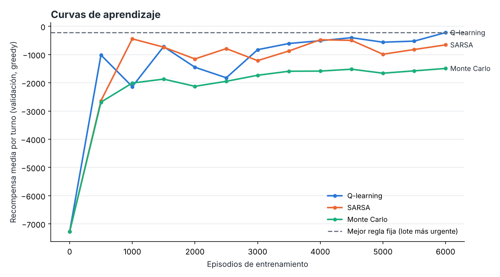
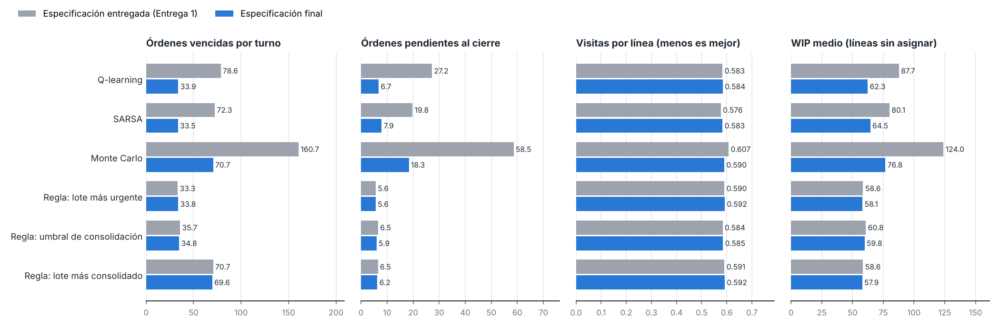

# rl-warehouse-agent

Repositorio del proyecto del curso **Aprendizaje por Refuerzo** (Maestría en Inteligencia Artificial, Universidad de los Andes). Contiene la definición del ambiente, los agentes y los experimentos para entrenar y comparar algoritmos de RL en un problema de toma de decisiones secuenciales.

**Problema:** un agente decide qué trabajo de picking liberar en un centro de distribución (un lote consolidado por zona de racks, una orden urgente o esperar) para recoger en una sola visita los SKU que piden varias órdenes, sin incumplir deadlines y considerando operarios libres y WIP.

## Estructura

```
rl-warehouse-agent/
├── docs/                  Documentación y entregas del curso
│   ├── entrega1/          Entrega 1: estados, acciones y recompensas (LaTeX + PDF), tal como se entregó
│   ├── entrega_final/     Reporte final (LaTeX + PDF)
│   └── referencias/       Artículos y material de apoyo
├── data/
│   ├── raw/               Datos originales (órdenes, ubicaciones de SKU) - no versionados
│   ├── processed/         Datos limpios listos para el simulador - no versionados
│   └── simulated/         Escenarios de órdenes generados - no versionados
├── src/rl_warehouse/      Código fuente
│   ├── env/               Simulador del centro de distribución (MDP)
│   ├── agents/            Agentes: Monte Carlo, SARSA, Q-learning, ...
│   └── utils/             Semillas, logging, métricas
├── configs/               Parámetros del ambiente y de entrenamiento (YAML)
├── experiments/           Scripts de entrenamiento y comparación de agentes
├── notebooks/             Exploración y análisis de resultados
├── results/
│   ├── figures/           Gráficas para los informes
│   ├── models/            Q-tablas entrenadas (.npz y .csv)
│   ├── logs/              Registros de entrenamiento y evaluación
│   └── entrega1/          Lo mismo, con la especificación entregada en la Entrega 1
├── tests/                 Pruebas unitarias
└── requirements.txt
```

## Entregas

| Entrega | Contenido | Archivo |
| --- | --- | --- |
| 1 | Definición de estados, acciones y función de recompensa R(s, a, s'), tal como se entregó | [`docs/entrega1/entrega1_definicion_mdp.pdf`](docs/entrega1/entrega1_definicion_mdp.pdf) |
| Final | Reporte: implementación, cambios a la especificación y su justificación, entrenamiento y resultados | [`docs/entrega_final/reporte_final.pdf`](docs/entrega_final/reporte_final.pdf) |
| Final | Q-tabla del agente (Q-learning) | [`results/models/q_learning.npz`](results/models/q_learning.npz) · [CSV legible](results/models/q_learning_qtable.csv) |
| Final | Video de un turno del agente | [`results/figures/demo.mp4`](results/figures/demo.mp4) |
| Final | Registros de las pruebas | [`results/logs/`](results/logs) · [`results/entrega1/logs/`](results/entrega1/logs) |

## Instalación con Conda

```powershell
conda env create -f environment.yml
conda activate rl-warehouse-agent
```

Para actualizar el ambiente tras cambios en sus dependencias:

```powershell
conda env update -f environment.yml
```

## Uso

```powershell
python -m pytest                                    # 29 pruebas, incluidas las triplas (s, a, s') de la Entrega 1
python experiments/train.py                         # entrena Q-learning, SARSA y Monte Carlo y los compara con reglas fijas
python experiments/train.py --config configs/env_entrega1.yaml --out results/entrega1   # con la especificación entregada
python experiments/compare_specs.py                 # especificación entregada frente a final
python experiments/analyze_policy.py --model results/models/q_learning.npz --compare lote_mas_urgente
python experiments/report_numbers.py                # cifras y tablas del reporte final
python experiments/demo.py --model results/models/q_learning.npz   # carga la Q-tabla y graba el video
```

La Q-tabla se guarda con `TabularAgent.save(ruta)` y se carga con `TabularAgent.load(ruta)` (`src/rl_warehouse/agents/tabular.py`). Detalles, supuestos del simulador y protocolo experimental: [`docs/implementacion.md`](docs/implementacion.md).

## Compilar los documentos LaTeX

```bash
cd docs/entrega_final
latexmk -pdf reporte_final.tex      # también docs/entrega1/entrega1_definicion_mdp.tex
latexmk -c                          # limpia archivos auxiliares
```

## Resultados (2 zonas)

6 000 turnos de entrenamiento por algoritmo y evaluación greedy en 100 turnos de prueba, con las mismas semillas para agentes y reglas fijas. Promedios por turno de 8 h; ± es el intervalo de confianza del 95 %.

| Política | Tipo | Recompensa | Vencidas | A tiempo | Pendientes al cierre | Viajes | WIP medio |
|---|---|---|---|---|---|---|---|
| **Q-learning** | RL | **−599** ± 339 | 33,9 ± 7,9 | 89,2 % | 6,7 | 80,6 | 62,3 |
| SARSA | RL | −732 ± 331 | 33,5 ± 7,8 | 88,9 % | 7,9 | 77,1 | 64,5 |
| Monte Carlo | RL | −2 433 ± 688 | 70,7 ± 14,6 | 77,7 % | 18,3 | 87,5 | 76,8 |
| Lote más urgente | regla | −426 ± 307 | 33,8 ± 7,2 | 89,3 % | 5,6 | 90,7 | 58,1 |
| Umbral de consolidación | regla | −561 ± 308 | 34,8 ± 7,4 | 88,9 % | 5,9 | 75,1 | 59,8 |
| Lote más consolidado | regla | −1 390 ± 450 | 69,6 ± 12,6 | 79,3 % | 6,2 | 90,7 | 57,9 |
| Aleatoria (agente sin entrenar) | regla | −7 322 ± 586 | 176,1 ± 12,6 | 46,1 % | 50,5 | 102,6 | 124,8 |

Q-learning pasa de 176 órdenes vencidas por turno sin entrenar a 33.9, el mismo nivel de servicio que la mejor regla fija, con 10 viajes menos por turno (diferencia pareada significativa). A cambio, mantiene unas 4 líneas más de WIP y en recompensa total queda por debajo de esa regla. Con la especificación entregada en la Entrega 1, el mismo algoritmo vence 78.6 órdenes por turno y la regla, 33.3: la recompensa entregada le enseñaba al agente a esperar con órdenes críticas. El reporte final explica cada cambio.



