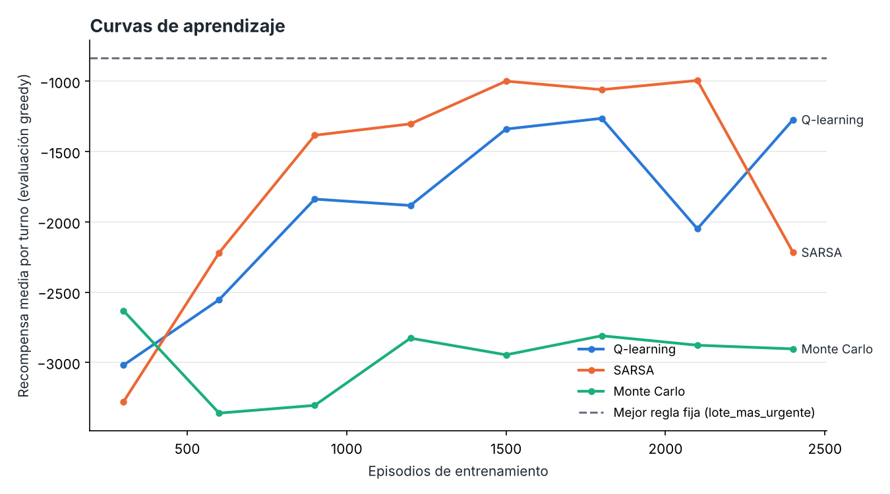
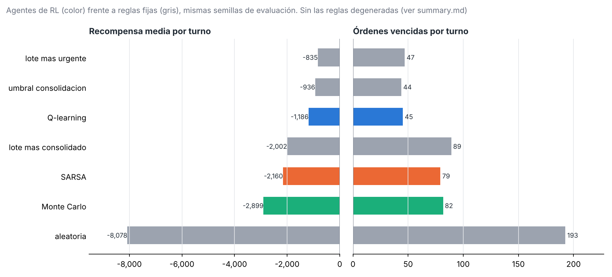

# rl-warehouse-agent

Repositorio del proyecto del curso **Aprendizaje por Refuerzo** (Maestría en Inteligencia Artificial, Universidad de los Andes). Contiene la definición del ambiente, los agentes y los experimentos para entrenar y comparar algoritmos de RL en un problema de toma de decisiones secuenciales.

**Problema:** un agente decide qué trabajo de picking liberar en un centro de distribución (un lote consolidado por zona de racks, una orden urgente o esperar) para recoger en una sola visita los SKU que piden varias órdenes, sin incumplir deadlines y considerando operarios libres y WIP.

## Estructura

```
rl-warehouse-agent/
├── docs/                  Documentación y entregas del curso
│   ├── entrega1/          Entrega 1: estados, acciones y recompensas (LaTeX + PDF)
│   └── referencias/       Artículos y material de apoyo
├── data/
│   ├── raw/               Datos originales (órdenes, ubicaciones de SKU) - no versionados
│   ├── processed/         Datos limpios listos para el simulador - no versionados
│   └── simulated/         Escenarios de órdenes generados - no versionados
├── src/rl_warehouse/      Código fuente
│   ├── env/               Simulador del centro de distribución (MDP)
│   ├── agents/            Agentes: Monte Carlo, SARSA, Q-learning, ...
│   └── utils/             Semillas, logging, métricas
├── configs/               Parámetros del ambiente y de entrenamiento (YAML)
├── experiments/           Scripts de entrenamiento y comparación de agentes
├── notebooks/             Exploración y análisis de resultados
├── results/
│   ├── figures/           Gráficas para los informes
│   ├── models/            Tablas Q / modelos entrenados - no versionados
│   └── logs/              Registros de entrenamiento - no versionados
├── tests/                 Pruebas unitarias
└── requirements.txt
```

## Entregas

| Entrega | Contenido | Archivo |
| --- | --- | --- |
| 1 | Definición de estados, acciones y función de recompensa R(s, a, s') | [`docs/entrega1/entrega1_definicion_mdp.pdf`](docs/entrega1/entrega1_definicion_mdp.pdf) |

## Instalación con Conda

```powershell
conda env create -f environment.yml
conda activate rl-warehouse-agent
```

Para actualizar el ambiente tras cambios en sus dependencias:

```powershell
conda env update -f environment.yml
```

## Compilar los documentos LaTeX

```bash
cd docs/entrega1
latexmk -pdf entrega1_definicion_mdp.tex     # o: pdflatex entrega1_definicion_mdp.tex (dos veces)
latexmk -c                                   # limpia archivos auxiliares
```

También se puede subir la carpeta `docs/entrega1` a Overleaf y compilar con pdfLaTeX.

Los valores numéricos del documento (discretización y recompensas) están replicados en `configs/env_default.yaml`; si se cambia uno, hay que cambiar el otro.

## Simulador y entrenamiento

Implementación ejecutable de Gymnasium, agentes Q-learning, SARSA y Monte Carlo, reglas fijas de referencia, pruebas y comparación reproducible. Consulta [instrucciones y supuestos](docs/implementacion.md).

```powershell
conda activate rl-warehouse-agent
python -m pytest
python experiments/train.py --zones AB --episodes 3000          # entrenar y comparar (versión de 2 zonas)
python experiments/demo.py --zones AB --model results/models/q_learning.npz   # video del agente
```

| Script | Qué produce |
| --- | --- |
| `experiments/train.py` | Q-tablas (`results/models/*.npz` y `*_qtable.csv`), curvas de aprendizaje, comparación contra reglas fijas (`results/logs`, `results/figures`) |
| `experiments/demo.py` | Carga una Q-tabla con `TabularAgent.load` y graba un turno como video (`results/figures/demo.mp4`) |

## Resultados actuales (2 zonas)

2 400 episodios por algoritmo (α = 0,05, γ = 0,95 por cada 2 min, ε de 0,5 a 0,02) y evaluación greedy en 20 turnos con las mismas semillas para agentes y reglas fijas. Valores por turno de 8 h; se reproducen con `python experiments/train.py --zones AB`.

| Política | Tipo | Recompensa | A tiempo | Vencidas | Pendientes al cierre | Viajes |
|---|---|---|---|---|---|---|
| Lote de la zona más urgente | regla | −835 | 311 | 47 | 6 | 90 |
| Umbral de consolidación | regla | −936 | 314 | 44 | 7 | 75 |
| **Q-learning** | RL | **−1186** | 312 | 45 | 10 | 82 |
| Lote de mayor consolidación | regla | −2002 | 269 | 89 | 8 | 90 |
| SARSA | RL | −2160 | 277 | 79 | 11 | 79 |
| Monte Carlo | RL | −2899 | 272 | 82 | 24 | 96 |
| Aleatoria | regla | −8079 | 156 | 193 | 57 | 101 |

Q-learning aprende una política del nivel de las mejores reglas fijas: vence una cantidad similar de órdenes con menos viajes, pero deja más órdenes pendientes al cierre. La desviación entre turnos es grande (unos ±1 400 de recompensa), así que con 20 turnos la diferencia frente a las dos mejores reglas no es concluyente. SARSA llegó a −1 000 a mitad del entrenamiento y luego se degradó: la curva oscila porque el estado agregado no distingue situaciones distintas (ver `docs/implementacion.md`).




Video de un turno del agente de Q-learning: [`results/figures/demo.mp4`](results/figures/demo.mp4). Las Q-tablas (`results/models`) y los registros (`results/logs`) no se versionan; `train.py` los regenera.

