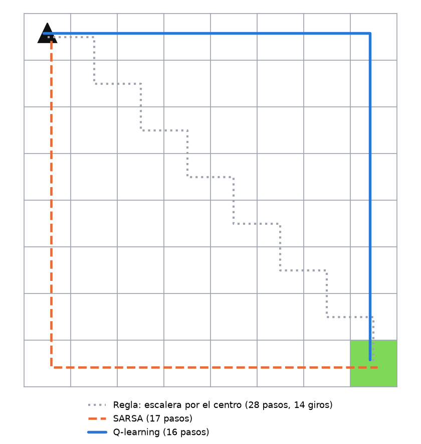

# rl-warehouse-agent

Repositorio del proyecto del curso **Aprendizaje por Refuerzo** (Maestría en Inteligencia Artificial, Universidad de los Andes).

## Proyecto del curso: cuarto 8x8 con obstáculos móviles

Un agente (triángulo) parte de la casilla (0,0) mirando al norte y debe llegar a la meta (7,7) sin chocar con cinco obstáculos que se mueven al azar en cada paso, al mismo tiempo que él. Puede girar 90° a la izquierda o a la derecha, o avanzar a la casilla de enfrente si existe. Siguiendo las aclaraciones del curso, el agente **no ve los obstáculos** (su Q-tabla depende solo de posición y orientación), los obstáculos no se superponen ni entran en la salida ni en la meta, y no hay límite de pasos.

| Entregable | Archivo |
| --- | --- |
| Definición de estados, acciones y recompensas | [`docs/proyecto_8x8/definicion_ambiente.pdf`](docs/proyecto_8x8/definicion_ambiente.pdf) |
| Reporte final | [`docs/proyecto_8x8/reporte_final.pdf`](docs/proyecto_8x8/reporte_final.pdf) |
| Video del agente | [`results/cuarto_8x8/figures/demo.mp4`](results/cuarto_8x8/figures/demo.mp4) |
| Q-tabla | [`results/cuarto_8x8/models/q_learning.npz`](results/cuarto_8x8/models/q_learning.npz) · [CSV legible](results/cuarto_8x8/models/q_learning_qtable.csv) |
| Registros de las pruebas | [`results/cuarto_8x8/logs/`](results/cuarto_8x8/logs) |
| Código | [`src/rl_gridworld/`](src/rl_gridworld) · [`experiments/cuarto_8x8/`](experiments/cuarto_8x8) · [`tests/test_gridworld.py`](tests/test_gridworld.py) |

```powershell
conda env create -f environment.yml
conda activate rl-warehouse-agent
python -m pytest tests/test_gridworld.py                # 20 pruebas, incluidas las triplas (s, a, s') del documento
python experiments/cuarto_8x8/train.py                  # entrena Q-learning y SARSA y los compara con reglas fijas
python experiments/cuarto_8x8/demo.py                   # carga la Q-tabla y graba el video
python experiments/cuarto_8x8/demo.py --human           # lo muestra en una ventana
```

La Q-tabla se guarda con `TabularAgent.save(ruta)` y se carga con `TabularAgent.load(ruta)` (`src/rl_gridworld/agent.py`).

**Resultados** (2 000 episodios de prueba; ± es el intervalo de confianza del 95 %):

| Política | Llega a la meta | Choca | Pasos si llega |
|---|---|---|---|
| **Q-learning** | 35,1 % ± 2,1 | 64,9 % | 16,0 |
| SARSA | 34,4 % ± 2,1 | 65,6 % | 17,0 |
| Regla: por el borde | 35,1 % ± 2,1 | 64,9 % | 16,0 |
| Regla: escalera por el centro | 15,9 % ± 1,6 | 84,1 % | 28,0 |
| Aleatoria (sin entrenar) | 0,4 % ± 0,3 | 99,6 % | 71,4 |

El agente aprendió por su cuenta la ruta por el borde (derecha por la fila 0 y abajo por la columna 7, con dos giros), que es la de menos riesgo cuando no se ven los obstáculos. Como experimento adicional (`configs/cuarto_8x8_sensores.yaml`, no es el ambiente del curso), con sensores de obstáculos Q-learning llega a la meta en el 65,2 %.



## Trabajo complementario: consolidación de picking en un centro de distribución

Antes de enfocarnos en el ambiente del enunciado desarrollamos un agente para decidir qué trabajo de picking liberar en un centro de distribución (`src/rl_warehouse`, `docs/entrega1`, `docs/entrega_final`, `results/`). Se conserva como trabajo complementario; el resto de este documento lo describe.

## Estructura

```
rl-warehouse-agent/
├── docs/                  Documentación y entregas del curso
│   ├── proyecto_8x8/      Proyecto del curso: definición del ambiente y reporte final (LaTeX + PDF)
│   ├── entrega1/          Centro de distribución: Entrega 1 tal como se entregó
│   ├── entrega_final/     Centro de distribución: reporte
│   └── referencias/       Artículos y material de apoyo
├── data/
│   ├── raw/               Datos originales (órdenes, ubicaciones de SKU) - no versionados
│   ├── processed/         Datos limpios listos para el simulador - no versionados
│   └── simulated/         Escenarios de órdenes generados - no versionados
├── src/rl_gridworld/      Código del cuarto 8x8: ambiente, agentes, reglas y render
├── src/rl_warehouse/      Código del centro de distribución
│   ├── env/               Simulador del centro de distribución (MDP)
│   ├── agents/            Agentes: Monte Carlo, SARSA, Q-learning, ...
│   └── utils/             Semillas, logging, métricas
├── configs/               Parámetros del ambiente y de entrenamiento (YAML)
├── experiments/           Scripts de entrenamiento y comparación de agentes
├── notebooks/             Exploración y análisis de resultados
├── results/
│   ├── cuarto_8x8/        Q-tablas, registros, figuras y video del cuarto 8x8
│   ├── cuarto_8x8_sensores/  Experimento adicional con sensores de obstáculos
│   ├── figures/           Gráficas para los informes
│   ├── models/            Q-tablas entrenadas (.npz y .csv)
│   ├── logs/              Registros de entrenamiento y evaluación
│   └── entrega1/          Lo mismo, con la especificación entregada en la Entrega 1
├── tests/                 Pruebas unitarias
└── requirements.txt
```

## Centro de distribución: entregas

| Entrega | Contenido | Archivo |
| --- | --- | --- |
| 1 | Definición de estados, acciones y función de recompensa R(s, a, s'), tal como se entregó | [`docs/entrega1/entrega1_definicion_mdp.pdf`](docs/entrega1/entrega1_definicion_mdp.pdf) |
| Final | Reporte: implementación, cambios a la especificación y su justificación, entrenamiento y resultados | [`docs/entrega_final/reporte_final.pdf`](docs/entrega_final/reporte_final.pdf) |
| Final | Q-tabla del agente (Q-learning) | [`results/models/q_learning.npz`](results/models/q_learning.npz) · [CSV legible](results/models/q_learning_qtable.csv) |
| Final | Video de un turno del agente | [`results/figures/demo.mp4`](results/figures/demo.mp4) |
| Final | Registros de las pruebas | [`results/logs/`](results/logs) · [`results/entrega1/logs/`](results/entrega1/logs) |

## Instalación con Conda

```powershell
conda env create -f environment.yml
conda activate rl-warehouse-agent
```

Para actualizar el ambiente tras cambios en sus dependencias:

```powershell
conda env update -f environment.yml
```

## Centro de distribución: uso

```powershell
python -m pytest                                    # 29 pruebas, incluidas las triplas (s, a, s') de la Entrega 1
python experiments/train.py                         # entrena Q-learning, SARSA y Monte Carlo y los compara con reglas fijas
python experiments/train.py --config configs/env_entrega1.yaml --out results/entrega1   # con la especificación entregada
python experiments/compare_specs.py                 # especificación entregada frente a final
python experiments/analyze_policy.py --model results/models/q_learning.npz --compare lote_mas_urgente
python experiments/report_numbers.py                # cifras y tablas del reporte final
python experiments/demo.py --model results/models/q_learning.npz   # carga la Q-tabla y graba el video
```

La Q-tabla se guarda con `TabularAgent.save(ruta)` y se carga con `TabularAgent.load(ruta)` (`src/rl_warehouse/agents/tabular.py`). Detalles, supuestos del simulador y protocolo experimental: [`docs/implementacion.md`](docs/implementacion.md).

## Compilar los documentos LaTeX

```bash
cd docs/entrega_final
latexmk -pdf reporte_final.tex      # también docs/entrega1/entrega1_definicion_mdp.tex
latexmk -c                          # limpia archivos auxiliares
```

## Centro de distribución: resultados (2 zonas)

6 000 turnos de entrenamiento por algoritmo y evaluación greedy en 100 turnos de prueba, con las mismas semillas para agentes y reglas fijas. Promedios por turno de 8 h; ± es el intervalo de confianza del 95 %.

| Política | Tipo | Recompensa | Vencidas | A tiempo | Pendientes al cierre | Viajes | WIP medio |
|---|---|---|---|---|---|---|---|
| **Q-learning** | RL | **−599** ± 339 | 33,9 ± 7,9 | 89,2 % | 6,7 | 80,6 | 62,3 |
| SARSA | RL | −732 ± 331 | 33,5 ± 7,8 | 88,9 % | 7,9 | 77,1 | 64,5 |
| Monte Carlo | RL | −2 433 ± 688 | 70,7 ± 14,6 | 77,7 % | 18,3 | 87,5 | 76,8 |
| Lote más urgente | regla | −426 ± 307 | 33,8 ± 7,2 | 89,3 % | 5,6 | 90,7 | 58,1 |
| Umbral de consolidación | regla | −561 ± 308 | 34,8 ± 7,4 | 88,9 % | 5,9 | 75,1 | 59,8 |
| Lote más consolidado | regla | −1 390 ± 450 | 69,6 ± 12,6 | 79,3 % | 6,2 | 90,7 | 57,9 |
| Aleatoria (agente sin entrenar) | regla | −7 322 ± 586 | 176,1 ± 12,6 | 46,1 % | 50,5 | 102,6 | 124,8 |

Q-learning pasa de 176 órdenes vencidas por turno sin entrenar a 33.9, el mismo nivel de servicio que la mejor regla fija, con 10 viajes menos por turno (diferencia pareada significativa). A cambio, mantiene unas 4 líneas más de WIP y en recompensa total queda por debajo de esa regla. Con la especificación entregada en la Entrega 1, el mismo algoritmo vence 78.6 órdenes por turno y la regla, 33.3: la recompensa entregada le enseñaba al agente a esperar con órdenes críticas. El reporte final explica cada cambio.


